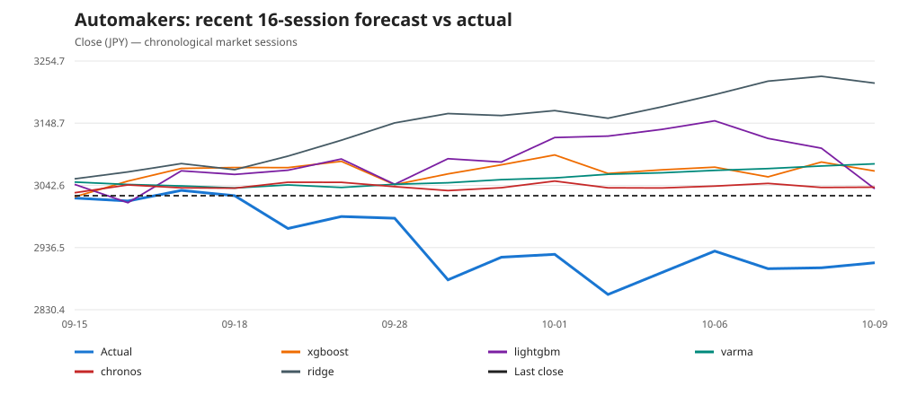
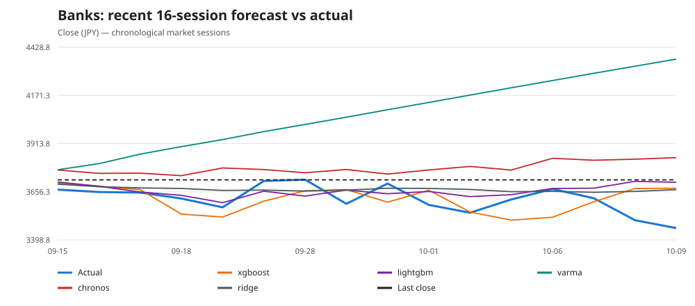
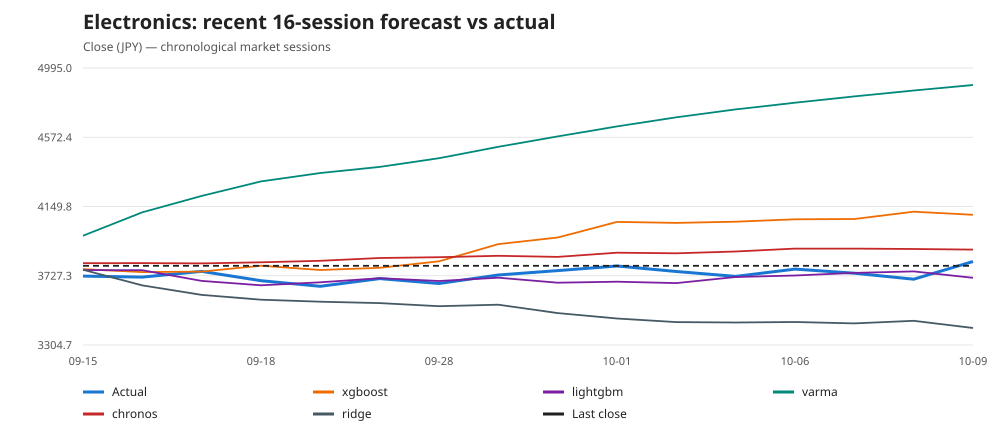
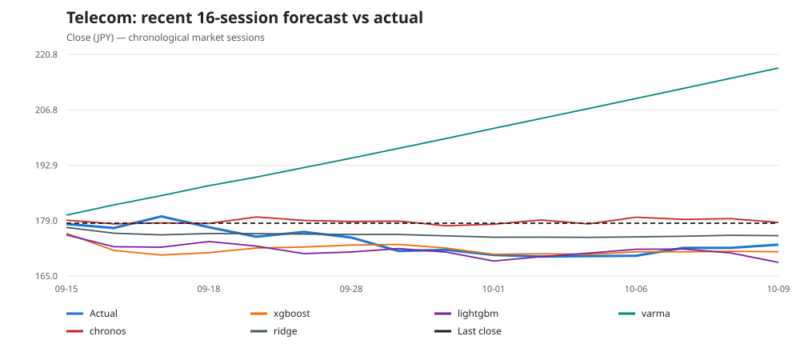
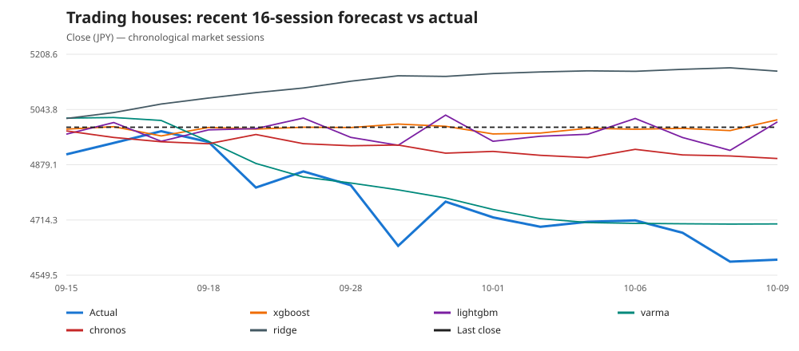
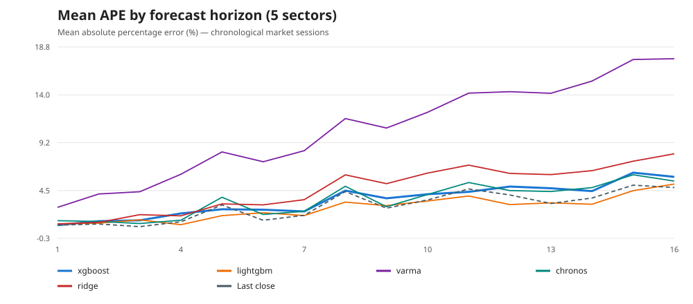

# [Client-Side Time-Series Forecast](https://github.com/europanite/client_side_time_series_forecast "Client-Side Time-Series Forecast")

[](https://opensource.org/licenses/Apache-2.0)

[](https://github.com/europanite/client_side_time_series_forecast/actions/workflows/ci.yml)
[](https://github.com/europanite/client_side_time_series_forecast/actions/workflows/docker.yml)
[](https://github.com/europanite/client_side_time_series_forecast/actions/workflows/pages.yml)


<p align="right">
  <a href="./README.md">🇺🇸 English</a> |
  <a href="./README.hi.md">🇮🇳 हिंदी </a> |
  <a href="./README.ja.md">🇯🇵 日本語</a> |
  <a href="./README.zh-CN.md">🇨🇳 简体中文</a> |
  <a href="./README.es.md">🇪🇸 Español</a> |
  <a href="./README.pt-BR.md">🇧🇷 Português (Brasil)</a> |
  <a href="./README.ko.md">🇰🇷 한국어</a> |
  <a href="./README.de.md">🇩🇪 Deutsch</a> |
  <a href="./README.fr.md">🇫🇷 Français</a>
</p>

## 30-Second Demo

[](https://youtu.be/qoiuBfhwuLE)

## PlayGround

[▶ Open the browser-based forecasting app](https://europanite.github.io/client_side_time_series_forecast/)

Browser-Based Client-Side Time-Series Forecast Tool. This tool is completely free and safe because it runs only on your web browser.

You can choose [XGBoost](https://xgboost.readthedocs.io/en/stable/), [LightGBM](https://lightgbm.readthedocs.io/), an experimental VARMA-style model, [Chronos-2](https://github.com/amazon-science/chronos-forecasting), and Ridge regression.

---

## Overview

This is a multivariate time series forecasting tool that runs entirely in your web browser.
No installation, registration, or payment required. 
Just access it with your browser and you're ready to go.
It helps small businesses predict tomorrow's orders.

- Load CSV/XLSX time-series datasets in the browser
- Select any numeric column as the forecast target
- Choose among XGBoost, LightGBM, an experimental VARMA-style model, pretrained Chronos-2, and Ridge regression
- Train the selected model locally in the browser
- Forecast the next 16 points and append them to the chart

Everything happens **inside your browser**. There is no backend API and no data leaves your machine.

---

## Demo

1. Open the GitHub Pages demo:  
   https://europanite.github.io/client_side_time_series_forecast/
2. Upload a sample file such as [`data/sample_data.csv`](./data/sample_data.csv) (stock prices) or [`data/sample_data.xlsx`](./data/sample_data.xlsx) (synthetic multivariate sample).
3. The app will:
   - Detect a **datetime-like column**
   - List available numeric columns
4. Choose one numeric column as the **target**.
5. Choose a **forecast model**. `XGBoost` is the default, `LightGBM` is an alternative locally trained GBDT, `VARMA experimental` is a lightweight multivariate baseline, `Chronos-2 pretrained` is a zero-shot foundation model, and `Ridge` is a locally trained linear baseline.
6. For XGBoost, LightGBM, VARMA, or Ridge, click **Train** first. Chronos-2 is already pretrained and does not require local training. Then click **Forecast +16** to predict the next 16 points.
7. Inspect the chart to compare the observed series and the forecast line.

---

## Data Structure

<pre>
datetime,item_a,item_b,item_c,...
2025-01-01 00:00:00+09:00,10,20,31,...
2025-01-02 00:00:00+09:00,12,19,31,...
2025-01-03 00:00:00+09:00,14,18,33,...
 ...
</pre>

### Requirements:

##### One datetime-like column
Column header contains "date" or "time" (case-insensitive).
Used as the time axis but not converted directly to numeric features.

##### One or more numeric columns
These columns are used as the target and/or exogenous features.
The app supports four locally fitted forecasting modes:

- **XGBoost**: you pick one numeric column as the target, and other numeric columns are used as additional signals.
- **LightGBM**: uses the same target and engineered multivariate features as XGBoost, but fits a LightGBM regressor.
- **VARMA experimental**: all numeric columns are modeled together, and the selected target column is displayed as the forecast output.
- **Ridge**: locally fitted regularized linear regression over the same engineered features and recursive prediction path as XGBoost and LightGBM.

---

## Forecasting Approach

The project exposes five forecasting algorithms with deliberately different
assumptions:

| Model | Learning style | Uses multiple input series? | Local training? | Forecast style |
| --- | --- | --- | --- | --- |
| XGBoost | Gradient-boosted decision-tree regression over engineered time-series features | Yes | Yes | Recursive or direct 16-horizon forecasting |
| LightGBM | Histogram-based gradient-boosted decision-tree regression over the same engineered features as XGBoost | Yes | Yes | Recursive or direct 16-horizon forecasting |
| VARMA experimental | Linear multi-output autoregression with ridge regularization and residual correction | Yes, jointly | Yes | Joint recursive multi-output forecasting |
| Chronos-2-small INT8 ONNX | Pretrained patch-based time-series foundation model | Selected target only in the current UI | No | Direct probabilistic multi-step forecasting |
| Ridge (linear baseline) | L2-regularized linear regression over the engineered features shared with the tree models | Yes | Yes | Recursive or direct 16-horizon forecasting |

These models should not be interpreted as five implementations of the same
algorithm. XGBoost and LightGBM convert the time series into the same supervised
tabular-learning problem, VARMA models lagged vectors of several series jointly,
Ridge provides a linear reference over the same supervised features,
and Chronos-2 uses a pretrained neural forecasting model without fitting new
parameters to the uploaded dataset.

**Direct 16-step is the default forecasting strategy** for XGBoost, LightGBM,
and Ridge. Each future step is fitted independently, avoiding artificial future
peer inputs. To switch to recursive forecasting, open **Settings → Advanced
forecasting → Forecast strategy**. Recursive uses one model and iteratively
forecasts all 16 steps. VARMA uses joint multiseries autoregression;
Chronos-2 is pretrained and predicts directly. No fixed seasonal blend is
applied to supervised model predictions. See
[forecast strategies](docs/FORECAST_STRATEGIES.md).

### Model selection

#### XGBoost

`XGBoost` is the default locally trained model. XGBoost is a gradient-boosted
decision-tree algorithm: many decision trees are added sequentially, with each
new tree reducing errors left by the previous ensemble. Time series are not
passed to XGBoost directly. This project first converts each time step into a
feature vector and then trains XGBoost as a regression model.

The browser implementation uses:

- target and exogenous lags up to `MAX_LAG = 3`
- first differences
- a `ROLLING_WINDOW = 7` rolling mean
- spread, ratio, and product interactions between numeric series
- a time index
- Fourier features with periods 24 and 168
- `gbtree` with depth 4, learning rate 0.1, subsample 0.8, and 200 boosting iterations

In **recursive** mode the model predicts one step at a time; each prediction
becomes history for the next step, and unknown future peer series are continued
heuristically. In **direct** mode, 16 independently fitted horizon models use
the last real observed features without inventing future peer values.
No fixed seasonal blending is applied to model predictions.

**Strengths**

- captures nonlinear relationships and interactions between series
- works naturally with the project's hand-engineered multivariate features
- trains locally and relatively quickly in the browser
- does not require a large pretrained model download

**Limitations**

- forecasting quality depends on the chosen feature engineering
- recursive forecasting can accumulate errors over later steps
- the Fourier periods and seasonal continuation are application-level
  assumptions rather than automatically learned calendar structure

Use XGBoost when you want a lightweight, locally trained nonlinear model that
can exploit relationships among several numeric columns.

#### LightGBM

`LightGBM` is a second locally trained gradient-boosted decision-tree model.
The browser implementation uses `@wlearn/lightgbm`, a WebAssembly build of
LightGBM, and intentionally reuses the same `buildFeatures()` output and
16-step forecasting strategies as XGBoost (recursive or direct).

The default LightGBM configuration uses regression, learning rate 0.1,
31 leaves, max depth 4, subsample 0.8, and 200 boosting rounds. Raw model
forecasts are used without fixed seasonal blending.

Use LightGBM when you want a directly comparable histogram-based GBDT
alternative while keeping the feature pipeline and application-level forecast
protocol fixed.

#### VARMA experimental

`VARMA experimental` is a lightweight browser-native multivariate baseline.
Despite the name, this implementation is **not a full statistical
maximum-likelihood VARMA estimator**. It is closer to a regularized VAR-style
model with a small residual correction and optional seasonal stabilization.

The implementation:

1. selects up to 8 numeric series and standardizes them;
2. concatenates the previous 7 multivariate vectors into a lag feature vector;
3. fits all output series simultaneously with multi-output ridge regression
   (`ridge = 1e-2`);
4. estimates a small correction from recent residuals (`maLag = 1`);
5. optionally blends the autoregressive output with a seasonal lag vector
   (`seasonalLag = 7`; default `seasonalBlend = 0`);
6. recursively feeds the predicted vector back into the next forecast step.

Because the complete numeric vector is predicted at each step, VARMA advances
all modeled series together rather than forecasting only the selected target.

**Strengths**

- simple and computationally inexpensive
- models several numeric series jointly
- provides a useful linear/classical-style baseline against XGBoost and
  Chronos-2
- runs entirely in TypeScript without a separate model download

**Limitations**

- requires at least two numeric series and more than 7 usable rows
- assumes mostly linear lag relationships
- the residual correction and optional seasonal blending are heuristic,
  not a complete moving-average estimation procedure
- should not be presented as a reference implementation of statistical VARMA

Use `VARMA experimental` mainly as a transparent multivariate baseline when
several series move together.

#### Chronos-2 pretrained

`Chronos-2 pretrained` is fundamentally different from the two locally fitted
models above. Chronos-2 is a pretrained, patch-based time-series foundation
model that produces direct multi-step **quantile forecasts**. This repository
runs `Chronos-2-small INT8` as an ONNX model with ONNX Runtime Web, so inference
is performed locally after the model has been downloaded.

The current browser integration:

- does **not** train on the uploaded dataset;
- uses only the selected target series as Chronos context;
- requires at least 16 numeric target observations;
- keeps at most 5,760 context observations;
- groups the input into 16-point patches, left-padding an incomplete first
  patch with `NaN`;
- runs the ONNX graph's internal 672-step output
  (`42 × 16`) and exposes the first 16 steps to the UI;
- reads the model's quantile output and displays the median (`p50`) forecast
  together with `p10` and `p90` uncertainty bounds.

Chronos-2 itself supports richer multivariate and covariate-informed
forecasting, but **the current UI does not yet use those capabilities**.
Therefore the present Chronos implementation should be understood as a
pretrained univariate target forecaster inside an otherwise multivariate
application.

**Strengths**

- zero-shot forecasting: no per-dataset model fitting is required
- directly predicts the full forecast horizon instead of recursively fitting
  one-step models
- provides probabilistic information through forecast quantiles
- can transfer patterns learned during large-scale pretraining to a new series

**Limitations**

- the model must be downloaded before first use
- the browser uses an INT8 ONNX export, so results need not exactly match a
  full-precision official checkpoint
- the current UI ignores additional numeric columns when calling Chronos-2
- browser memory and WASM execution place practical limits on model size and
  context length

In a previously recorded AirPassengers 128/16 holdout benchmark,
`Chronos-2-small INT8 ONNX` achieved the lowest MAE, RMSE, MAPE, sMAPE, and
MASE among the comparable models. See the benchmark section below for the
measured values and evaluation protocol. **These are historical results from
an earlier app version and must not be compared with the revised feature and
forecast strategies without re-running the evaluation.**

### 16-step forecast

The application-level default horizon is 16 because the integrated Chronos-2
ONNX model uses 16-point patches, and the XGBoost, LightGBM, and VARMA APIs are
aligned to the same horizon for comparison.

The algorithms reach those 16 points differently:

- **XGBoost, LightGBM, and Ridge** can either predict recursively from one
  fitted one-step model, or directly using 16 horizon-specific models.
- **VARMA experimental** predicts the full multivariate vector recursively,
  so all included series are advanced together.
- **Chronos-2** performs direct multi-step probabilistic inference and returns
  the first 16 future positions from the pretrained model output.

The direct strategy is the **default** for XGBoost, LightGBM, and Ridge.
The recursive strategy is an advanced option under Settings. Direct forecasting
avoids iterative input fabrication at the cost of fitting up to 16 models. Results between strategies must be compared on the same
out-of-sample windows. Neither strategy guarantees an accuracy advantage.

---

## Feature Engineering (XGBoost / LightGBM)

The hand-engineered features in this section apply to both the XGBoost and
LightGBM pipelines. VARMA uses normalized lag vectors directly, while Chronos-2
operates on the selected target sequence without these features.

The tree-boosting pipelines treat the input as a small multi-variate time series:

- One *datetime-like* column (header contains `date` or `time` in any case).
- Several numeric columns (e.g., `item_a`, `item_b`, `item_c`, ...).
- One of the numeric columns is chosen as the **target** to forecast.

Internally, the feature builder constructs a **rich feature vector** for each time step `t` and a **future feature vector** for `t + 1`. All features are computed **purely on the client**, in JavaScript/TypeScript.

### Series used for features

- `datetimeKey`  
  - Detected automatically from the header that contains `"date"` or `"time"`.
  - Only used for locating the time axis; not used directly as a numeric feature.
- `targetKey`  
  - Numeric column the user chooses to forecast.
- `featureKeys`  
  - All other numeric columns (non-datetime, non-target).
  - Treated as **exogenous series**.

Internally we keep a `seriesMap: Record<string, number[]>` with one numeric array per series.

### Per-series features (exogenous series)

For every exogenous series `x(t)` (each key in `featureKeys`) and each time step `t`, we compute:

1. **Contemporaneous value**
   - `x(t)` (the value at time index `t`).

2. **Lag features (history)**
   - Up to `MAX_LAG = 3`:
     - `x(t - 1)`
     - `x(t - 2)`
     - `x(t - 3)`
   - This allows the model to learn short-term temporal dynamics per series.

3. **First difference**
   - `x(t) - x(t - 1)`
   - Captures local changes (trend / slope) rather than absolute level only.

4. **Rolling mean (local average)**
   - Rolling window of `ROLLING_WINDOW = 7` time steps:
     - `mean(x[t - 6 ... t])` (truncated near the beginning of the series)
   - Represents local trend / baseline level and smooths short-term noise.

> If the series is shorter than the window, the code automatically shrinks the window so that all available past points up to `t` are used.

### Target-series history

For the **target series** `y(t)` itself, we do **not** include the current value `y(t)` as a feature (because it is the label at that step), but we do include its history:

1. **Target lags**
   - `y(t - 1)`
   - `y(t - 2)`
   - `y(t - 3)`

2. **Target difference**
   - `y(t) - y(t - 1)`

3. **Target rolling mean**
   - Same rolling window as above:
     - `mean(y[t - 6 ... t])`

This lets the model learn patterns like “the next value depends on the last few values and their local trend,” which is typical in time-series forecasting.

### Cross-series interactions

To capture **relationships between different series**, we build interaction features for every **pair of numeric series** (including the target):

- Let `v_i(t)` and `v_j(t)` be the contemporaneous values of two series at time `t`.
- For each ordered pair `(i, j)` with `i < j`, we compute:

1. **Spread**
   - `v_i(t) - v_j(t)`
   - Encodes relative level differences between series.

2. **Ratio**
   - `v_i(t) / v_j(t)`
   - To avoid division by zero, the denominator includes a small epsilon if needed:
     - `denom = |v_j| < 1e-9 ? sign(v_j) * 1e-9 : v_j`
   - Encodes relative scale and proportionality.

3. **Product**
   - `v_i(t) * v_j(t)`
   - Allows the model to express “interaction effects” where both series being large or small matters.

These cross-series features explicitly expose **multi-series structure** to the booster instead of relying only on individual series values.

### Time index and Fourier features

We also encode time itself as numeric features:

1. **Time index**
   - Integer index `t = 0, 1, 2, ...` (row index).
   - Gives the booster a simple way to model global trends.

2. **Fourier features** (cyclical patterns)
   - Two periods (in units of “number of rows”):
     - Period 24 (e.g., 24 hours in hourly data)
     - Period 168 (e.g., 7 days × 24 hours)
   - For each period `P` we compute:
     - `sin(2πt / P)`
     - `cos(2πt / P)`
   - This is a standard way to embed seasonality/cycles in a form that tree models can still exploit.

The final feature vector for each time step `t` is:

```text
[ exogenous features (current, lags, diff, rolling mean for each series),
  target-series history (lags, diff, rolling mean),
  cross-series interactions (spread, ratio, product),
  time index, sin/cos(2πt/24), sin/cos(2πt/168) ]
```

### Future-step feature vector (lastFeatureRow)
The same feature-building logic is used to produce a feature vector for t + 1 (one-step-ahead prediction):
- Conceptually, we treat the next time index as t_next = n where n is the number of observed rows.
- For the “current” values of each series at t_next, we reuse the last observed value (index n - 1).
- Lags and rolling means are computed using the last MAX_LAG / ROLLING_WINDOW steps in the observed data.
- Time encodings use t_next as the time index.
- This gives a single feature vector lastFeatureRow that represents the next time step based on all history up to the last observation.

The buildFeatures function therefore returns:
```text
{
  X: number[][];        // feature matrix for all observed steps
  y: number[];          // target series values for those steps
  lastFeatureRow: number[]; // feature vector representing t + 1
}
```

---


## 🚀 Getting Started

### 1. Prerequisites
- [Docker Compose](https://docs.docker.com/compose/)

### 2. Build and start all services:

```bash

# Build the image
docker compose build

# Run the container
docker compose up

```

### 3. Test:
```bash
docker compose \
-f docker-compose.test.yml up \
--build --exit-code-from \
frontend_test
```

---

<!-- FRONTEND_STOCK_EVALUATION:START -->
## Real frontend stock forecasting benchmark

**As-used browser forecasting functions**, evaluated 2026-10-11T23:54:55.451Z UTC; latest observed session **2026-10-09**.
Two non-overlapping 16-session holdouts (256 prior training sessions per origin). All five app models and a last-close baseline use the same fixed target and all predeclared domestic sector peers.

| Group | Model | Previous 16 MAPE ↓ | Recent 16 MAPE ↓ | Recent 1-step APE ↓ | Recent direction hit ↑ |
| --- | --- | ---: | ---: | ---: | ---: |
| Automakers | xgboost | 7.55% | 4.08% | 0.07% | 12.50% |
| Automakers | lightgbm | 2.58% | 4.74% | 0.77% | 12.50% |
| Automakers | varma | 11.82% | 3.67% | 0.90% | 6.25% |
| Automakers | chronos | 1.86% | 3.20% | 0.30% | 6.25% |
| Automakers | ridge | 2.69% | 6.78% | 1.08% | 6.25% |
| Automakers | last_close | 2.26% | 2.70% | 0.13% | N/A |
| Banks | xgboost | 3.56% | 2.27% | 0.91% | 93.75% |
| Banks | lightgbm | 3.13% | 1.89% | 1.10% | 93.75% |
| Banks | varma | 4.21% | 12.66% | 2.89% | 6.25% |
| Banks | chronos | 3.68% | 4.60% | 2.86% | 6.25% |
| Banks | ridge | 4.99% | 1.91% | 0.79% | 93.75% |
| Banks | last_close | 4.06% | 2.84% | 1.42% | N/A |
| Electronics | xgboost | 3.67% | 5.16% | 1.15% | 37.50% |
| Electronics | lightgbm | 3.58% | 1.09% | 0.98% | 93.75% |
| Electronics | varma | 5.13% | 21.04% | 6.62% | 6.25% |
| Electronics | chronos | 3.11% | 3.09% | 2.11% | 6.25% |
| Electronics | ridge | 7.11% | 5.62% | 1.04% | 93.75% |
| Electronics | last_close | 3.04% | 1.56% | 1.69% | N/A |
| Telecom | xgboost | 5.23% | 1.44% | 1.32% | 93.75% |
| Telecom | lightgbm | 5.96% | 1.47% | 1.53% | 93.75% |
| Telecom | varma | 13.19% | 14.50% | 1.26% | 6.25% |
| Telecom | chronos | 5.43% | 3.09% | 0.54% | 37.50% |
| Telecom | ridge | 7.14% | 1.65% | 0.48% | 93.75% |
| Telecom | last_close | 3.44% | 2.83% | 0.11% | N/A |
| Trading houses | xgboost | 3.08% | 4.58% | 1.53% | 75.00% |
| Trading houses | lightgbm | 2.78% | 4.40% | 1.23% | 68.75% |
| Trading houses | varma | 9.75% | 1.05% | 2.20% | 81.25% |
| Trading houses | chronos | 3.14% | 3.45% | 1.43% | 100.00% |
| Trading houses | ridge | 2.72% | 7.36% | 2.18% | 0.00% |
| Trading houses | last_close | 2.46% | 4.63% | 1.65% | N/A |

### Rolling next-session forecast (32 distinct origins per sector)

The model is refitted at each origin, using 256 earlier REAL market sessions for the target and all domestic peers. Only the next unseen close is predicted; no future peer extrapolation. These dates overlap the multi-step holdouts above.

| Group | Model | 1-step MAPE ↓ | 1-step direction hit ↑ | Last-close 1-step MAPE ↓ |
| --- | --- | ---: | ---: | ---: | ---: |
| Automakers | xgboost | 1.55% | 46.88% | 1.09% |
| Automakers | lightgbm | 1.71% | 53.13% | 1.09% |
| Automakers | varma | 1.81% | 50.00% | 1.09% |
| Automakers | chronos | 1.07% | 59.38% | 1.09% |
| Automakers | ridge | 1.47% | 65.63% | 1.09% |
| Banks | xgboost | 1.66% | 50.00% | 1.46% |
| Banks | lightgbm | 1.60% | 59.38% | 1.46% |
| Banks | varma | 1.85% | 56.25% | 1.46% |
| Banks | chronos | 1.78% | 40.63% | 1.46% |
| Banks | ridge | 1.66% | 43.75% | 1.46% |
| Electronics | xgboost | 1.40% | 50.00% | 1.30% |
| Electronics | lightgbm | 1.38% | 56.25% | 1.30% |
| Electronics | varma | 1.81% | 53.13% | 1.30% |
| Electronics | chronos | 1.36% | 43.75% | 1.30% |
| Electronics | ridge | 1.72% | 59.38% | 1.30% |
| Telecom | xgboost | 1.28% | 43.75% | 0.88% |
| Telecom | lightgbm | 1.47% | 46.88% | 0.88% |
| Telecom | varma | 1.41% | 46.88% | 0.88% |
| Telecom | chronos | 1.08% | 34.38% | 0.88% |
| Telecom | ridge | 1.13% | 40.63% | 0.88% |
| Trading houses | xgboost | 1.41% | 59.38% | 1.32% |
| Trading houses | lightgbm | 1.48% | 53.13% | 1.32% |
| Trading houses | varma | 2.36% | 37.50% | 1.32% |
| Trading houses | chronos | 1.27% | 50.00% | 1.32% |
| Trading houses | ridge | 1.69% | 46.88% | 1.32% |

### Rolling 1-step wins against last-close (across 5 sectors)

| Model | Wins (mean 1-step MAPE) |
| --- | ---: |
| xgboost | 0/5 |
| lightgbm | 0/5 |
| varma | 0/5 |
| chronos | 2/5 |
| ridge | 0/5 |

### Forecasts vs actual values (recent 16 sessions)

Each chart compares all five app models with actual closes and the same fixed-origin last-close baseline. The final chart shows how absolute percentage error changes with horizon; curves are descriptive, not confidence intervals.














### Recent MAPE wins against the 16-step last-close baseline

| Model | App forecast wins (of 5) |
| --- | ---: | ---: |
| xgboost | 3/5 |
| lightgbm | 4/5 |
| varma | 1/5 |
| chronos | 1/5 |
| ridge | 2/5 |

**Method:** Next-day rolling: 32 separate refits per sector, each predicting exactly the next market session using only historical observed prices. Multi-step: two fixed nonoverlapping 16-session holdouts (these dates overlap the rolling evaluation). Real `trainModel`, `trainLightGBMModel`, `trainVarmaModel`, `trainRidgeModel`, `forecastNextN`, `forecastVarmaNextN`, and `forecastChronosNext16` imported from the browser app; 16-step forecasts without peeking at held-out observations. Direction = change relative to the last known close at the forecast origin.

**Audit:** Supervised training features use only observations preceding each target, matching next-step inference. XGBoost/LightGBM/Ridge recursive forecasts are not combined with fixed seasonal forecasts. All models are scored without touching held-out rows. The scheduled 16-step benchmark continues to measure recursive (not the UI-default direct) forecasts for these three models.

**Limitations:** Rolling results (32 origins) are temporally dependent and share training data, not 32 independent experiments. Multi-step extrapolates future peer prices; rolling one-step does not. All predeclared domestic sector peers are supplied, but macro/foreign factors are excluded pending strict as-of timestamps. Market history is retrospectively downloaded and may be revised. This is not a live prediction audit, and reported accuracy is not evidence of tradable profit.

[Machine-readable results](./reports/stocks/frontend-evaluation.json) · [Protocol](./docs/FRONTEND_STOCK_EVALUATION.md)
<!-- FRONTEND_STOCK_EVALUATION:END -->

## Legacy separate-engine stock benchmark

**Default protocol for the next evaluation:** 256 trading sessions of rolling training,
256 sessions of long-window evaluation, and the final 32 sessions as the recent
subset. The measured tables below show their **actual run parameters** until
the next complete evaluation refreshes them; changing the configuration does
not retroactively change historical scores. The groups and once-daily
GitHub Actions schedule are unchanged.

<!-- STOCK_MULTIVARIATE:START -->
**Daily fixed-group, symmetric forecast benchmark.** Last evaluation: 2026-10-11T15:26:02.612Z UTC; last observed market session: 2026-10-09.
Pre-registered **5 fixed groups** ([definitions](./config/stock-evaluation-groups.json), config SHA-256 dd6f956e125a); no stock/group selection by test results.
Walk-forward forecast origins: **long 256 sessions** (2025-09-19–2026-10-09) and **recent 32 sessions** (2026-08-24–2026-10-09), with a 256 session rolling training window. Recent is INCLUDED in long, not independent.

### Long window — solo versus multivariate (same algorithm)
| Fixed group | Algorithm | Solo MAPE ↓ | Multi MAPE ↓ | Multi gain ↑ | Solo P/L | Multi P/L |
| --- | --- | ---: | ---: | ---: | ---: | ---: |
| Automakers | ridge | 1.48% | 1.52% | -2.85% | ¥-93534 | ¥-238853 |
| Automakers | xgboost | 1.67% | 1.64% | 1.56% | ¥-270455 | ¥-292549 |
| Automakers | lightgbm | 1.60% | 1.59% | 0.35% | ¥-286153 | ¥-331026 |
| Banks | ridge | 1.63% | 1.66% | -1.91% | +¥39805 | ¥-152407 |
| Banks | xgboost | 1.77% | 1.80% | -1.76% | ¥-226949 | ¥-106719 |
| Banks | lightgbm | 1.76% | 1.77% | -0.42% | ¥-164697 | ¥-21876 |
| Electronics | ridge | 1.69% | 1.70% | -1.05% | ¥-237826 | ¥-307345 |
| Electronics | xgboost | 1.83% | 1.91% | -4.22% | ¥-314020 | ¥-335041 |
| Electronics | lightgbm | 1.79% | 1.80% | -0.49% | ¥-237866 | ¥-248289 |
| Telecom | ridge | 0.81% | 0.82% | -0.96% | ¥-109435 | ¥-146633 |
| Telecom | xgboost | 0.85% | 0.87% | -2.59% | ¥-128703 | ¥-135498 |
| Telecom | lightgbm | 0.83% | 0.85% | -2.17% | ¥-51111 | ¥-103633 |
| Trading houses | ridge | 1.63% | 1.63% | 0.07% | ¥-199218 | ¥-231268 |
| Trading houses | xgboost | 1.77% | 1.69% | 4.98% | ¥-74919 | ¥-151980 |
| Trading houses | lightgbm | 1.69% | 1.66% | 1.57% | ¥-122945 | ¥-164222 |

### Recent window — solo versus multivariate (same algorithm)
| Fixed group | Algorithm | Solo MAPE ↓ | Multi MAPE ↓ | Multi gain ↑ | Solo P/L | Multi P/L |
| --- | --- | ---: | ---: | ---: | ---: | ---: |
| Automakers | ridge | 1.07% | 1.13% | -5.69% | ¥-38361 | ¥-9147 |
| Automakers | xgboost | 1.41% | 1.34% | 4.90% | +¥5683 | +¥17705 |
| Automakers | lightgbm | 1.33% | 1.34% | -1.20% | ¥-20987 | ¥-59313 |
| Banks | ridge | 1.47% | 1.52% | -3.23% | +¥41030 | +¥22426 |
| Banks | xgboost | 1.66% | 1.61% | 3.27% | ¥-7771 | +¥31970 |
| Banks | lightgbm | 1.49% | 1.55% | -3.70% | +¥17786 | +¥30480 |
| Electronics | ridge | 1.27% | 1.35% | -5.87% | +¥12256 | ¥-7098 |
| Electronics | xgboost | 1.45% | 1.50% | -3.66% | ¥-24145 | ¥-60459 |
| Electronics | lightgbm | 1.34% | 1.41% | -4.99% | ¥-64287 | ¥-54681 |
| Telecom | ridge | 0.90% | 0.87% | 2.92% | +¥8767 | +¥51857 |
| Telecom | xgboost | 1.04% | 1.01% | 3.10% | +¥26966 | +¥7521 |
| Telecom | lightgbm | 0.97% | 0.91% | 6.02% | +¥31385 | +¥11377 |
| Trading houses | ridge | 1.39% | 1.41% | -1.10% | ¥-14475 | ¥-48323 |
| Trading houses | xgboost | 1.50% | 1.53% | -2.04% | ¥-12041 | ¥-19063 |
| Trading houses | lightgbm | 1.34% | 1.43% | -6.74% | ¥-5331 | ¥-23129 |

### Recent paper trading and baselines
| Fixed group | Strategy | Direction hit | Net paper P/L | Return | Trades | Max drawdown |
| --- | --- | ---: | ---: | ---: | ---: | ---: |
| Automakers | ridge:target_only | 65.63% | ¥-38361 | -3.84% | 14 | 4.87% |
| Automakers | ridge:multivariate | 59.38% | ¥-9147 | -0.91% | 15 | 4.46% |
| Automakers | xgboost:target_only | 53.13% | +¥5683 | 0.57% | 14 | 3.76% |
| Automakers | xgboost:multivariate | 50.00% | +¥17705 | 1.77% | 17 | 4.32% |
| Automakers | lightgbm:target_only | 56.25% | ¥-20987 | -2.10% | 15 | 3.51% |
| Automakers | lightgbm:multivariate | 43.75% | ¥-59313 | -5.93% | 14 | 6.02% |
| Automakers | last_close | 0.00% | +¥0 | 0.00% | 0 | 0.00% |
| Automakers | Buy & Hold | N/A | ¥-68263 | -6.83% | 1 | 11.23% |
| Banks | ridge:target_only | 56.25% | +¥41030 | 4.10% | 25 | 2.62% |
| Banks | ridge:multivariate | 53.13% | +¥22426 | 2.24% | 22 | 2.73% |
| Banks | xgboost:target_only | 40.63% | ¥-7771 | -0.78% | 20 | 3.11% |
| Banks | xgboost:multivariate | 53.13% | +¥31970 | 3.20% | 22 | 3.26% |
| Banks | lightgbm:target_only | 53.13% | +¥17786 | 1.78% | 21 | 2.29% |
| Banks | lightgbm:multivariate | 53.13% | +¥30480 | 3.05% | 22 | 3.27% |
| Banks | last_close | 0.00% | +¥0 | 0.00% | 0 | 0.00% |
| Banks | Buy & Hold | N/A | ¥-17201 | -1.72% | 1 | 6.16% |
| Electronics | ridge:target_only | 56.25% | +¥12256 | 1.23% | 5 | 2.18% |
| Electronics | ridge:multivariate | 43.75% | ¥-7098 | -0.71% | 7 | 3.27% |
| Electronics | xgboost:target_only | 53.13% | ¥-24145 | -2.41% | 13 | 5.44% |
| Electronics | xgboost:multivariate | 46.88% | ¥-60459 | -6.05% | 12 | 6.63% |
| Electronics | lightgbm:target_only | 50.00% | ¥-64287 | -6.43% | 10 | 8.21% |
| Electronics | lightgbm:multivariate | 56.25% | ¥-54681 | -5.47% | 14 | 5.57% |
| Electronics | last_close | 0.00% | +¥0 | 0.00% | 0 | 0.00% |
| Electronics | Buy & Hold | N/A | ¥-6130 | -0.61% | 1 | 8.09% |
| Telecom | ridge:target_only | 53.13% | +¥8767 | 0.88% | 7 | 1.39% |
| Telecom | ridge:multivariate | 65.63% | +¥51857 | 5.19% | 9 | 0.30% |
| Telecom | xgboost:target_only | 59.38% | +¥26966 | 2.70% | 11 | 3.03% |
| Telecom | xgboost:multivariate | 43.75% | +¥7521 | 0.75% | 11 | 3.05% |
| Telecom | lightgbm:target_only | 56.25% | +¥31385 | 3.14% | 15 | 3.37% |
| Telecom | lightgbm:multivariate | 59.38% | +¥11377 | 1.14% | 17 | 3.06% |
| Telecom | last_close | 3.13% | +¥0 | 0.00% | 0 | 0.00% |
| Telecom | Buy & Hold | N/A | +¥36364 | 3.64% | 1 | 5.61% |
| Trading houses | ridge:target_only | 34.38% | ¥-14475 | -1.45% | 7 | 3.02% |
| Trading houses | ridge:multivariate | 50.00% | ¥-48323 | -4.83% | 17 | 5.46% |
| Trading houses | xgboost:target_only | 37.50% | ¥-12041 | -1.20% | 11 | 2.42% |
| Trading houses | xgboost:multivariate | 56.25% | ¥-19063 | -1.91% | 19 | 4.22% |
| Trading houses | lightgbm:target_only | 53.13% | ¥-5331 | -0.53% | 13 | 3.27% |
| Trading houses | lightgbm:multivariate | 59.38% | ¥-23129 | -2.31% | 14 | 3.40% |
| Trading houses | last_close | 0.00% | +¥0 | 0.00% | 0 | 0.00% |
| Trading houses | Buy & Hold | N/A | ¥-32669 | -3.27% | 1 | 8.84% |

History snapshots: **1** market dates; same-market-date reruns replace their record. The reporting job runs daily, including non-trading days; no bar is fabricated.
Long and recent P/L each start from a separate ¥1,000,000 virtual balance **per group**; they must NOT be added together. 100-share lots, long only, predicted rise over 0.20% signals next open buy and same close sell; 5bps fee and 5bps slippage **per side**. No taxes/dividends.
Historical scores use retrospectively retrieved Yahoo data (not a timestamped live-prediction archive). **Daily rolling windows overlap; profit and accuracy do not establish live predictability.** Foreign factors are lagged an additional calendar day; same-session prices never enter features.
Stock-group WASM benchmark compares Ridge/XGBoost/LightGBM, not Chronos-2 or experimental VARMA. Browser UI uses a separate feature pipeline.

[Full recent + long JSON](./reports/stocks/multivariate.json) · [History](./reports/stocks/group-history.json) · [Methodology](./STOCK_EVALUATION.md).
<!-- STOCK_MULTIVARIATE:END -->

The [group definitions](./config/stock-evaluation-groups.json) are intentionally independent of past scores. Every group receives the same models and window, with target-only, last-close and Buy & Hold controls. [Full protocol](./STOCK_EVALUATION.md).

---

## AirPassengers Benchmark

See [`BENCHMARKS.md`](./BENCHMARKS.md) for the fair 16-step protocol and paper-comparison rules.

The repository includes an AirPassengers dataset and a benchmark command for checking model behavior against a classic monthly time-series dataset.

Run the benchmark with Docker Compose:

```bash
docker compose -f docker-compose.test.yml run --rm air_passengers_benchmark
```

JSON output:

```bash
docker compose -f docker-compose.test.yml run --rm air_passengers_benchmark \
  node scripts/benchmark-air-passengers.mjs --json
```

Seasonal naive baseline:

```bash
docker compose -f docker-compose.test.yml run --rm air_passengers_benchmark \
  node scripts/benchmark-air-passengers.mjs --algorithm seasonal-naive --json
```


### 16-step holdout benchmark

- train: first 128 AirPassengers observations
- holdout: next 16 observations
- no holdout target value is fed back during forecasting
- common point metrics: MAE, RMSE, MAPE, sMAPE, and MASE

Reproduce the benchmark with:

```bash
docker compose -f docker-compose.test.yml run --rm \
  air_passengers_benchmark \
  sh -lc '
    npm --prefix frontend/app ci &&
    node scripts/benchmark-air-passengers-fair.mjs --markdown
  '
```

LightGBM-only AirPassengers evaluation:

```bash
docker compose -f docker-compose.test.yml run --rm \
  lightgbm_air_passengers_benchmark
```

This runs the same 128/16 protocol with
`--algorithm lightgbm`, so the result is directly comparable with the other
AirPassengers rows.

Archived results measured before the current leakage-safe feature alignment
(kept for historical reference, **not** comparable with new runs). Re-run the
complete benchmark to obtain new scores for all models:

| Model | Train | Horizon | MAE | RMSE | MAPE | sMAPE | MASE |
| --- | ---: | ---: | ---: | ---: | ---: | ---: | ---: |
| seasonal-naive | 128 | 16 | 64.2500 | 68.0808 | 14.1651% | 15.4031% | 2.1748 |
| xgboost | 128 | 16 | 24.5775 | 29.5014 | 5.5687% | 5.3717% | 0.8319 |
| LightGBM WASM | 128 | 16 | 21.0028 | 26.9474 | 4.4133% | 4.4352% | 0.7109 |
| Chronos-2-small INT8 ONNX | 128 | 16 | **14.7839** | **17.3376** | **3.2438%** | **3.2636%** | **0.5004** |
| VARMA experimental | 128 | 16 | N/A | N/A | N/A | N/A | N/A |

In that archived 16-step AirPassengers holdout, Chronos-2-small INT8 ONNX produced
the lowest error on every reported point metric. This is an application-level
comparison, not a direct reproduction of aggregate scores from the Chronos-2
paper.

In those archived results, LightGBM WASM outperformed XGBoost on every reported
point metric.

VARMA is reported as N/A because AirPassengers is univariate while this
repository's experimental VARMA implementation requires at least two numeric
series. See [`BENCHMARKS.md`](./BENCHMARKS.md) for the multivariate and
paper-comparison protocol.

## Multivariate LightGBM Benchmark

The repository also includes a multivariate LightGBM evaluation
using `data/sample_data_synthetic.csv`, which contains the numeric series `ITEM_A`,
`ITEM_B`, and `ITEM_C`.

By default:

- the final 16 rows are the holdout;
- the preceding rows are the training/context window;
- each numeric column is evaluated once as the target;
- the other numeric columns are available to the same engineered feature
  pipeline used by the browser app;
- no numeric value from the holdout is fed back during recursive forecasting;
- non-target series are advanced with the application's seasonal-continuation
  policy;
- LightGBM is compared with a seasonal-naive baseline;
- MAE, RMSE, MAPE, sMAPE, and MASE are reported per target and as macro means.

Run it with Docker Compose:

```bash
docker compose -f docker-compose.test.yml run --rm \
  lightgbm_multivariate_benchmark
```

JSON output:

```bash
docker compose -f docker-compose.test.yml run --rm \
  lightgbm_multivariate_benchmark \
  sh -lc '
    npm --prefix frontend/app ci &&
    node scripts/benchmark-multivariate-lightgbm.mjs --json
  '
```

Evaluate one target only:

```bash
docker compose -f docker-compose.test.yml run --rm \
  lightgbm_multivariate_benchmark \
  sh -lc '
    npm --prefix frontend/app ci &&
    node scripts/benchmark-multivariate-lightgbm.mjs \
      --target ITEM_A --algorithm lightgbm --markdown
  '
```

---

# License
- Apache License 2.0
